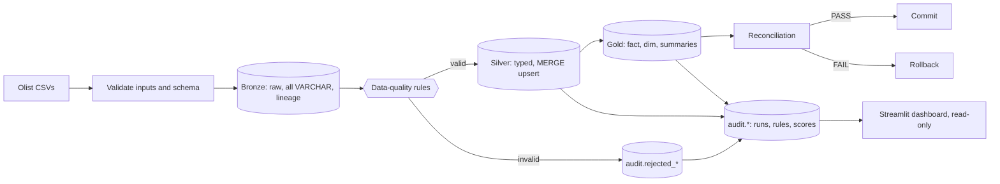

# DataGuard (OrderFlow pipeline)

An end-to-end data-quality and pipeline-validation framework for the Olist Brazilian e-commerce dataset. It ingests raw CSVs
into a DuckDB **Medallion** warehouse (Bronze, Silver, Gold), validates and quarantines bad records, reconciles every layer,
records each run for monitoring, and serves the results in a Streamlit dashboard. Built for the YottaFlex AI 72-hour challenge.

> **Status of verification (read this first).** The pipeline, tests, dashboard and benchmarks were executed and verified in a
> sandbox **without access to Kaggle**, so every result below was produced from the **clearly labelled synthetic generator**
> (`scripts/generate_data.py`, ids prefixed `syn`) and from hand-built known-answer fixtures. The real Olist CSVs have **not**
> been run through this code yet. Section 8 gives the exact steps; sections 16-18 must be regenerated on the real data
> before submission. Nothing here claims real-dataset results.

## 1. Business problem
E-commerce analytics are only as trustworthy as the data beneath them. Orders arrive with missing customers, impossible
timestamps, duplicate keys and negative prices. Silently dropping them hides problems; silently keeping them corrupts revenue.
DataGuard keeps every raw record, rejects only genuinely invalid ones **with a recorded reason**, publishes only validated data,
and proves with reconciliation that nothing was lost or double counted.

## 2. Objectives
Preserve raw data exactly (Bronze) - validate and standardise (Silver) - publish analytics tables (Gold) - quarantine rejects
with lineage - detect duplicates deterministically - make reruns idempotent - roll back on failure - monitor runs - test it all.

## 3. Technology stack
Python 3.12 (verified; 3.11 should work), Pandas, DuckDB (SQL, `MERGE INTO`), Pytest (+pytest-cov), Streamlit, Plotly, CSV and Parquet, Git.
No Airflow, Snowflake, Docker or paid services. Everything runs locally.

## 4. Architecture

More detail: `docs/architecture.md`.

## 5. Medallion layers
| Layer | Tables | Grain | Purpose |
|---|---|---|---|
| Bronze | `bronze.orders_raw`, `customers_raw`, `order_items_raw` | one row per source CSV row | Exact text values plus `source_file`, `source_file_hash`, `source_row_number`, `ingestion_timestamp`, `run_id` |
| Silver | `silver.orders_clean` (order_id), `customers_clean` (customer_id), `order_items_clean` (order_id + order_item_id) | one row per business key | Typed, trimmed, validated, deduplicated |
| Gold | `fact_orders` (order), `dim_customers` (customer_unique_id), `sales_summary` (month x status x state), `delivery_performance` (month x state) | as stated | Analytics-ready |
| Audit | `rejected_*`, `pipeline_runs`, `processed_files`, `schema_checks`, `table_run_stats`, `rule_results`, `null_profile`, `quality_scores`, `reconciliation` | | Quarantine and monitoring |

`customer_id` is per-order; `customer_unique_id` is the real person. `dim_customers` is therefore grained on `customer_unique_id`
so purchase frequency is correct. Gold `fact_orders` pre-aggregates items **before** joining, so a 5-item order is one row and
revenue is never multiplied.

## 6. Data-quality rules
| Table | Rule | Dimension |
|---|---|---|
| all | required business keys / fields present | completeness |
| orders | status in {created, approved, invoiced, processing, shipped, delivered, unavailable, canceled} | validity |
| orders | each of the 5 timestamps parses as `YYYY-MM-DD HH:MM:SS` when present | validity |
| orders | delivered-to-customer date not before purchase | validity |
| orders | status `delivered` requires a delivery date (a shipped/canceled order without one is **valid**) | validity |
| orders | `order_id` unique; `customer_id` exists in Silver customers | uniqueness / referential |
| customers | state is two letters; city contains letters; `customer_id` unique | validity / uniqueness |
| order_items | price and freight numeric and non-negative; `product_id`, `seller_id` present; `shipping_limit_date` parses | validity / completeness |
| order_items | `(order_id, order_item_id)` unique; `order_id` exists in Silver orders | uniqueness / referential |

**Quality score.** For each rule, `pass_rate = 1 - failed/evaluated` (a rule is evaluated only on rows it applies to).
`dimension score = 1 - sum(failed)/sum(evaluated)` over all rules of that dimension. **Overall = unweighted mean of the four
dimension scores.** Each row can fail several rules, so scores are rule-level pass rates, not row-level. The score is reported,
never optimised: no legitimate record is deleted to improve it.

## 7. Installation
```bash
python -m venv .venv && source .venv/bin/activate     # Windows: .venv\Scripts\activate
pip install -r requirements.txt
```

## 8. Dataset (real data) - download and attribution
**Source:** Olist, *Brazilian E-Commerce Public Dataset by Olist*, https://www.kaggle.com/datasets/olistbr/brazilian-ecommerce,
licensed **CC BY-NC-SA 4.0** (attribution, non-commercial, share-alike). This project is non-commercial, and derived material
should keep the same licence. Raw data is **not** committed (see `.gitignore`).

```bash
python scripts/download_dataset.py          # uses Kaggle credentials if present, otherwise prints manual steps
python scripts/download_dataset.py --verify # profiles the files and writes data/raw/dataset_profile.json (rows + columns)
```
Manual route: download the zip from the URL above and copy `olist_orders_dataset.csv`, `olist_customers_dataset.csv`,
`olist_order_items_dataset.csv` into `data/raw/`. API route: put `kaggle.json` in `~/.kaggle/` (or set `KAGGLE_USERNAME`/`KAGGLE_KEY`,
see `.env.example`) and `pip install kaggle`.
**Expected, from the Kaggle page and not verified here:** about 99k orders, 99k customers, 113k order items. The first real run
may reject a handful of `delivered` orders lacking a delivery date; that is the intended behaviour of the rule above, and the
count belongs in the final report.

## 9. Running
```bash
python scripts/run_pipeline.py                       # real data in data/raw/ -> database/dataguard.duckdb
python scripts/run_pipeline.py --force               # reprocess files already processed (backfill)
python scripts/generate_data.py --orders 1000 10000 100000   # labelled synthetic data -> data/synthetic/<n>/
python scripts/run_pipeline.py --raw-dir data/synthetic/10000 --db database/synthetic.duckdb --data-source synthetic
python scripts/export_parquet.py                     # Gold -> Parquet
python scripts/benchmark.py                          # performance benchmark
streamlit run streamlit_app/app.py                   # dashboard (DATAGUARD_DB overrides the database path)
python -m pytest --cov=src                           # tests
```
Use a separate `--db` for synthetic runs so synthetic rows never mix with real data.

## 10. Dashboard
Five pages: Executive Overview, Data Quality, Rejected Records (search, filter, CSV download), Pipeline Monitoring, Data Explorer.
Every figure comes from a DuckDB query (read-only connections; `tests/test_dashboard.py` renders each page against a real
temporary database, checks the missing-database error state, and asserts connections cannot write). **Screenshots are not
included**: the build sandbox had no browser. Capture them after `streamlit run` and put them in `docs/screenshots/`.

## 11. Idempotency
* **File identity = SHA-256 of content.** A file already in `audit.processed_files` is skipped (`SKIPPED_NO_NEW_DATA`), even if renamed.
* **Bronze** has PK `(file_hash, source_row_number)` and uses `ON CONFLICT DO NOTHING`.
* **Silver** is written with `MERGE INTO` on the business key; re-delivered keys update, never duplicate.
* **Quarantine** for a file is deleted and rewritten inside the transaction, so it always reflects the latest rules.
* **Gold** is rebuilt from Silver (`CREATE OR REPLACE`) inside the same transaction.
* Verified by `tests/test_idempotency.py`: same files twice, forced reprocess, renamed copy, re-delivered key, partial new files.

**Duplicate policy.** Within a batch rows are ordered by `source_row_number`; the first occurrence of a key is kept and later
ones are quarantined as `DUPLICATE_*`. Across batches a re-delivered key is an upsert, not a rejection.

**Late-arriving and out-of-order data.** A child arriving before its parent (item before order) is quarantined as an orphan, not
lost. When the parent arrives, `run_pipeline.py --force` re-evaluates the child file and clears the quarantine (tested). Stale
records cannot regress an order: the Silver MERGE only updates when `status_rank` is greater or equal (a late `shipped` never overwrites `delivered`).

## 12. Error handling and recovery
Schema/IO checks run before any write. Bronze commits in its own transaction (raw data is kept even if later steps fail).
Silver, quarantine, Gold, reconciliation and metrics run in **one transaction**; any exception, including a reconciliation
failure, rolls all of it back, so Gold is never partial (tested by injecting faults at each stage). A failed run is recorded in
`audit.pipeline_runs` with `failure_reason`. **Restart** = run the same command; because the failed run never marked the files
processed, they are reprocessed and Bronze is not duplicated. Transient `OSError`s are retried 3 times with backoff; logic errors fail fast.

## 13. Tests
83 passed in 32.83s; line coverage of `src/` **97%**. Full verbose output: `reports/test_results.txt`. Strategy: `docs/test_strategy.md`.
Categories: unit, integration, negative (empty, missing/unexpected columns, malformed CSV, orphans, bad status, negative price,
bad dates, duplicate keys), reliability (rerun, failure and retry, partial failure, late data, schema drift), regression, dashboard smoke.
Tests use temporary DuckDB files and a hand-computed fixture whose expected answers live apart in `data/expected/`.

## 14. Sample output (synthetic data, run `run_20261107T101251_1c6d7d`)
Source: `data/synthetic/10000` (generated with `--seed 1`, 2% injected anomalies per type; see its `MANIFEST.json`). Files in `reports/sample_synthetic/`.
| Table | Source | Valid | Rejected | Duplicates |
|---|---:|---:|---:|---:|
| customers | 9,180 | 8,820 | 360 | 180 |
| orders | 10,200 | 8,859 | 1,341 | 198 |
| order_items | 16,485 | 13,207 | 3,278 | 643 |

| Dimension | Score | Checks evaluated | Checks failed |
|---|---:|---:|---:|
| completeness | 0.9950 | 143,460 | 718 |
| validity | 0.9936 | 195,443 | 1,260 |
| uniqueness | 0.9714 | 35,663 | 1,021 |
| referential | 0.9028 | 26,685 | 2,594 |
| overall | 0.9657 | 401,251 | 5,593 |

## 15. Reconciliation (same synthetic run)
A single FAIL aborts the run.
| Check | Expected | Actual | Status |
|---|---:|---:|---|
| customers: source rows == bronze rows | 9180 | 9180 | PASS |
| customers: bronze rows == silver-valid + rejected | 9180 | 9180 | PASS |
| orders: source rows == bronze rows | 10200 | 10200 | PASS |
| orders: bronze rows == silver-valid + rejected | 10200 | 10200 | PASS |
| order_items: source rows == bronze rows | 16485 | 16485 | PASS |
| order_items: bronze rows == silver-valid + rejected | 16485 | 16485 | PASS |
| silver.orders == gold.fact_orders (rows) | 8859 | 8859 | PASS |
| silver items price == gold items_revenue | 1185670.56 | 1185670.56 | PASS |
| silver items freight == gold freight_total | 209557.40 | 209557.40 | PASS |
| gold.sales_summary orders == fact_orders rows | 8859 | 8859 | PASS |
| gold.dim_customers order_count == fact_orders rows | 8859 | 8859 | PASS |
| silver order items with no silver order (orphans) | 0 | 0 | PASS |

## 16. Performance benchmark (synthetic data, one run per size, measured)
Machine: the build sandbox (not a production host). Peak RSS includes the in-process data generator, so it overstates the pipeline's memory.
Numbers vary run to run; treat differences under about 10% as noise.

**Before optimisation**
| Orders | Input rows | Read + schema (s) | Bronze load (s) | Silver (s) | Gold (s) | Recon + metrics (s) | Total (s) | Rows/s | Peak RSS (MB) |
|---:|---:|---:|---:|---:|---:|---:|---:|---:|---:|
| 1,000 | 3,561 | 0.10 | 0.06 | 0.23 | 0.02 | 0.11 | 0.52 | 6,877 | 202 |
| 10,000 | 35,594 | 0.20 | 0.15 | 0.78 | 0.03 | 0.21 | 1.37 | 25,953 | 285 |
| 100,000 | 356,687 | 1.18 | 1.48 | 6.06 | 0.16 | 0.72 | 9.60 | 37,157 | 707 |

**After optimisation**
| Orders | Input rows | Read + schema (s) | Bronze load (s) | Silver (s) | Gold (s) | Recon + metrics (s) | Total (s) | Rows/s | Peak RSS (MB) |
|---:|---:|---:|---:|---:|---:|---:|---:|---:|---:|
| 1,000 | 3,561 | 0.08 | 0.06 | 0.20 | 0.02 | 0.12 | 0.47 | 7,568 | 198 |
| 10,000 | 35,594 | 0.18 | 0.16 | 0.70 | 0.04 | 0.28 | 1.36 | 26,180 | 286 |
| 100,000 | 356,687 | 1.17 | 1.61 | 3.91 | 0.16 | 0.73 | 7.58 | 47,044 | 700 |

**Optimisation.** `cProfile` on the 100k run showed about 40% of time in `_quarantine`, in a row-wise `DataFrame.apply(axis=1)` that built
`record_id`. Replacing it with vectorised string concatenation cut Silver from 6.06 s to 3.91 s and total from 9.60 s to 7.58 s at
100,000 orders (about 357k input rows). Re-run `python scripts/benchmark.py` on your machine and on real data to refresh these tables.

## 17. Known limitations
* Real Kaggle data not yet run through the pipeline (see top). Dashboard screenshots not captured.
* Verified on Python 3.12 only. Single-writer DuckDB: do not run two pipelines against one file at once.
* Gold is fully rebuilt each run (simple and correct; incremental would be needed for very large data).
* Late-arriving children need a manual `--force` backfill; there is no scheduler.
* Rows deleted at the source are not propagated. The first-occurrence duplicate rule can drop a good second row if the first
  occurrence is bad. Foreign-key lookups hold ids in memory (fine to millions of rows).
* Source row number assumes one CSV record per line (quoted newlines would shift it).
* `status_rank` ordering is a modelling choice, documented in `docs/design_decisions.md`.

## 18. Future improvements
Incremental Gold, Parquet-backed Bronze, scheduler hook, per-column type drift checks, more Olist tables (payments, reviews, products),
Great Expectations-style rule config in YAML, screenshots in CI.

## 19. Suggested commit history
1. `chore: project skeleton, config, gitignore, requirements`
2. `feat: duckdb schemas and bronze ingestion with lineage and idempotent load`
3. `feat: schema validation, quality rules, deterministic dedup policy`
4. `feat: silver MERGE upserts, quarantine tables, gold builds`
5. `feat: pipeline runner with atomic transaction, retry, reconciliation, monitoring`
6. `test: unit, integration, negative, reliability and regression suites`
7. `feat: synthetic data generator and benchmark; perf: vectorise quarantine record_id`
8. `feat: streamlit dashboard (five pages) and dashboard smoke tests`
9. `docs: readme, data dictionary, design decisions, test strategy, prompt history`

## 20. Attribution
Dataset: Olist and Andre Sionek, Kaggle, CC BY-NC-SA 4.0. AI assistance is disclosed in `PROMPT_HISTORY.md`.
