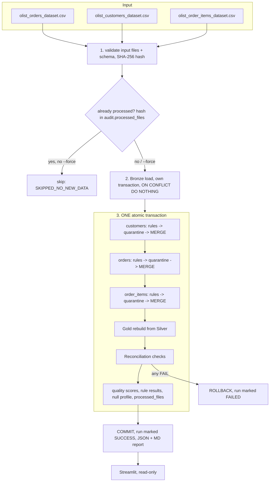

# Architecture

## Module responsibilities
| Module | Responsibility |
|---|---|
| `config.py` | paths, source schemas, valid statuses, status ranks, retry settings |
| `database.py` | connections, DDL for four schemas |
| `ingestion.py` | read CSV as text, field-count check, hash, Bronze load/read |
| `schema_validation.py` | missing columns (fail) vs unexpected columns (warn) |
| `data_quality.py` | rule builders, per-table rule sets, `evaluate`, null profile, quality score |
| `deduplication.py` | deterministic first-occurrence duplicate mask |
| `transformations.py` | pure trimming/typing functions |
| `medallion.py` | quarantine, Silver MERGE, Gold SQL |
| `reconciliation.py` | batch and cross-layer checks |
| `monitoring.py` | JSON logging, run bookkeeping, retry |
| `reporting.py` | persist metrics, write reports |
| `pipeline.py` | orchestration and transaction boundaries |

Processing order is customers, orders, order_items so each foreign-key rule checks the parent **after** the parent batch was merged.
